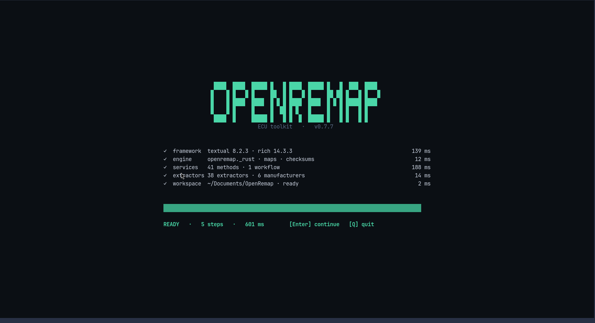
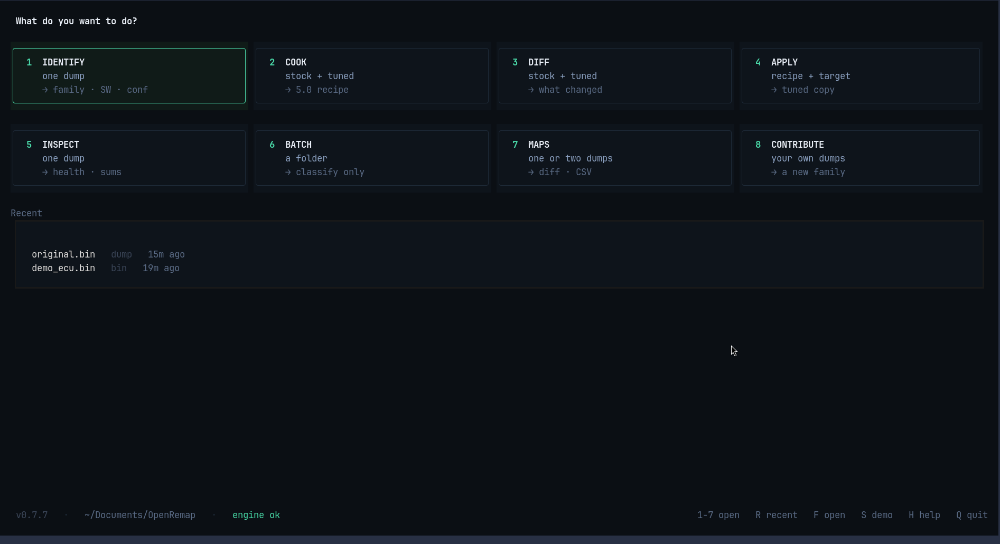

# OpenRemap

🌐 **[openremap.com](https://www.openremap.com)** — the project site: what OpenRemap is, how to install it, and the latest news.

📚 **[docs.openremap.com](https://docs.openremap.com)** — the wiki: concepts, every command, and per-family references.

🐙 **[openremap-docs](https://github.com/v-arapidis/openremap-docs)** — the open-source repo behind the docs/wiki — suggestions and contributions welcome.

[](https://github.com/v-arapidis/openremap-core/actions/workflows/ci.yml)
[](https://pypi.org/project/openremap/)
[](CHANGELOG.md)
[](LICENSE)
[](https://www.python.org/downloads/)
[](https://github.com/astral-sh/uv)

**The open-source ECU binary intelligence layer** — identify firmware,
health-check it, verify its checksums, diff a tune into a portable recipe,
and apply it to another binary of the same family.

Offline-first. No accounts, no telemetry, no data leaves your machine.

OpenRemap began as a final-semester thesis project, presented at
**SAEK Orestiadas** (v0.4.5), and has been actively developed since
(current release line: 0.9.x).

---

## Where the project is going (short-term roadmap)

**0.7.x (shipped):** a stability cycle for the engine — bugs that surfaced in
real use, third-party libraries ported with credit (never copy-pasted, see
[THIRD_PARTY.md](THIRD_PARTY.md)), and the tooling for *contributing* a new ECU
family (see [Contributing](#contributing) below).

**0.8.x — skipped, on purpose.** The plan was cross-firmware relocation: learn
a tune from one software revision and move it onto another by structural map
matching. We did not build it. Relocating a calibration across firmware
revisions is only safe when somebody who tunes for a living validates the
result, and that takes a partnership with tuning professionals that we do not
have. Without it the tune this tool produced would be **dangerous by default in
most cases** — and "the tool warned you" is not a safety story. A roadmap entry
is not worth a destroyed engine, so the line was dropped rather than shipped as
an experiment people could point at a real car.

**0.9.x (current):** the apply side was rebuilt around an explicit identity
policy — four commands on a ladder (`tune-strict` → `tune-shift` →
`tune-unique` → `tune-any`), a schema 5.0 recipe format and the producer that
writes it — and the TUI was rebuilt from scratch (below). What continues: bug
fixes and hotfixes, plus the infrastructure the desktop Harness needs and does
not have yet. Nothing on this line loosens the apply engine's safety rails to
buy a feature.

**1.0.0 — OpenRemap Harness:** a desktop app for Windows / macOS / Linux.
Development starts now, alongside 0.9.x.

---

## The new TUI

```bash
openremap                # no arguments: launch the TUI
```

`openremap-tui` is the same thing, and `--fast` skips the boot flourish. It needs
no browser, no server and no account — a terminal is the whole requirement (any
UTF-8 terminal: Windows Terminal, iTerm2, GNOME Terminal).

<p align="center">
  
</p>

<p align="center">
  
</p>

Eleven screens, each built around **one decision**: IDENTIFY, INSPECT, MAPS,
COOK, DIFF, APPLY, BATCH, CONTRIBUTE, plus HOME, BOOT and HELP. The file picker
is part of the app — no desktop dialogs, no `zenity`, keyboard first.

What it is opinionated about:

- **It shows what it does not know.** Checksums read `ok` / `fail` / **`skip`**
  ("no known scheme for this family" — not a pass); a table is an offset and a
  measured axis range, never a guessed name; on one real 4 MB pair DIFF
  reported 34 changed tables and **69 changed regions no table accounts for**,
  and shows both.
- **Nothing is written until you press the key, and the path is shown before
  you press it.** `⚠ NOT WRITTEN` and `⚠ NOT SAVED` sit above the key bar,
  because a result held in memory is a result a stray key destroys.
- **The mode is a property of the files, not a preference.** COOK and APPLY
  pick the safe rung first and offer the looser one only when the refusal's own
  rule says it helps — with what it gives up written on the key.
- **Every key it advertises works in the state it is advertised in**, and the
  key bar always fits 80 columns.
- **Every apply prints the standing disclaimer**: OpenRemap does not correct
  checksums automatically; a tune bound for a real vehicle needs a dedicated
  tuner shop; the supported use is right-to-repair and track racing.

It also remembers the last five files you worked on, and HOME opens each in the
screen that fits it.

---

## Quick start

```bash
pip install openremap        # or: uv tool install openremap

openremap identify stock.bin     # what is this ECU?  (family, SW, confidence)
openremap health  stock.bin      # is the file sane?  (checksums, maps, VINs)
openremap cook-strict stock.bin tuned.bin --output stage1.remap   # diff → 5.0 recipe
openremap tune-strict target.bin stage1.remap --output tuned.bin  # apply → verify
openremap synth   --output demo.bin                          # an ECU-like file, no ECU needed
openremap map-image tuned.bin --list                         # which calibration tables are in here?
openremap map-image tuned.bin --offset 0x3D53F4              # draw one as an SVG (values + axes)
```

Runs entirely offline. `.bin`, `.ori`, and `.hex` files are all accepted.

## What it is

- **Identify** — 38 extractors across 6 OEMs (Bosch, Siemens, Delphi,
  Magneti Marelli, Denso, Hitachi), each result with a confidence tier
  and the evidence behind it
- **Health-check** — one command: checksums, axis sanity, map-count
  envelope, erased blocks, VIN duplication (CI-gateable)
- **Checksums** — verifies ME7, IronFelix, NefMoto, MS43, GS20/SMG2 and
  Denso Subaru schemes (detection only, no correction)
- **Cook / tune** — diff stock vs tuned into a **schema-5.0** `.remap` recipe
  (`cook-strict` requires unique anchors, `cook-forced` accepts repeated ones),
  then apply it under an explicit identity policy (`tune-strict`, `-shift`,
  `-unique`, `-any`), each of which verifies the original bytes, the anchored
  position and the result before writing; merge recipes; audit the receipt.
  Applying says out loud what it does **not** do: checksums are reported
  (`ok` / `fail` / `skip`) and never corrected, and a tune bound for a real
  vehicle is a tune for a tuner shop to review
- **Map tooling** — structural map discovery, map-level diffing, CSV
  export, probabilistic labels
- **Synthetic fixtures** — `openremap synth` generates ECU-like binaries
  from scratch (deterministic, no ECU data involved), so you can try the
  tooling, build tests, or file a reproducible bug report without owning
  a dump. Generated files identify as *Unknown* by design.
- **Contribute an ECU family** — `openremap contribute` measures your own
  dump for a signature that is stable in that family and absent from every
  family the engine already recognises, then writes the fixture, an extractor
  skeleton, a test and a PR description. Your dump never leaves your machine.
- **A terminal app** — `openremap` with no arguments opens the TUI: eleven
  screens, its own file picker, and a refusal to print a number it has not
  measured (see [The new TUI](#the-new-tui) above)
- **Library-first** — every service is importable Python (identity,
  patching, map scanning) with a mandatory Rust core for the hot loops

## Supported ECUs

6 manufacturers, 38 extractors — from LH-Jetronic (1982) to EDC17 and
Denso/Hitachi Subaru (2020s). → [Per-family reference](https://docs.openremap.com/manufacturers/)

Own an ECU that is not listed? You can add support for it **without sharing your
dump** — `openremap contribute extractor my.bin --measure-only` runs offline and
tells you what the engine makes of the file.

## Decoders & CPU coverage

To extract code references and read routines, OpenRemap decodes the ECU's
CPU directly — no manufacturer lookup needed. Decoders power the
code-reference signal, CPU auto-detection, and the `routine` command's
pseudo-decompiler. Two backends cover the supported families:

- **Rust-native decoders** — written from scratch for CPUs that the capstone
  disassembly library does not support (C166/ST10, 8051, MCS-96), each
  verified against an independent oracle: Ghidra's SLEIGH spec (C166), the
  `at51` disassembler (8051 — 100% agreement on ~312k real instruction
  boundaries), and MAME's opcode tables + Ghidra (MCS-96).
- **Capstone-backed decoders** — the mature disassembly library, used for
  TriCore, SuperH, x86, M680X, 68K and PowerPC.

| CPU | Decoder | ECU families |
|---|---|---|
| C166 / ST10 | Rust | ME7, ME9, EDC15, MS43, PPD, SID801/803, EMS2000, M5.x, ME1.5.5 |
| 8051 (MCS-51) | Rust | M1.8, M2.x, MP9, M4.x, Mono-Motronic, SIMOS, Simtec56 |
| MCS-96 (8096) | Rust | EDC1, EDC3 |
| TriCore | capstone | EDC16, EDC17, MED9, MED17 |
| SuperH | capstone | SH7055, SH7058, SH72546 |
| M680X (68HC11 / 6800) | capstone | M1.3, M1.7, M3.x, MP3.x, MP7.2, LH-Jetronic |
| 68K (68000 / CPU32) | capstone | M1.5.5, M1.55, IAW 4LV |
| PowerPC | capstone | MJD 6JF |
| x86 | capstone | (generic code — bootloaders etc.) |

Every mapping above is evidence-backed: an internal audit established each
family's CPU from reset-vector header bytes and independent decoder
evidence, and corrected several extractor docstrings along the way (M2.x /
MP9 / M4.x are 8051, not 68xxx; EDC16 / MED9 are TriCore, not C166). The
16-bit Denso Subaru units are Motorola 68HC16 (CPU16) — capstone has no
HC16 support, so they are not disassembled. Denso EE20 is believed to be
SuperH per community docs, but there is no corpus binary to verify against
yet.

## Documentation

The wiki is live at **[docs.openremap.com](https://docs.openremap.com)** —
its content lives in the open-source
[`v-arapidis/openremap-docs`](https://github.com/v-arapidis/openremap-docs)
repo.  This repository keeps only repo-internal docs
([`docs/internal/`](docs/internal/) — dated audits and version audits).

- [Getting started](https://docs.openremap.com/getting-started/) — install, quick start, CLI, TUI
- [Concepts](https://docs.openremap.com/concepts/) — how it works, decoders, confidence, evidence, recipe format
- [Commands](https://docs.openremap.com/commands/) — every command, simple + advanced
- [Manufacturers](https://docs.openremap.com/manufacturers/) — per-OEM, per-family pages

## Contributing

See [CONTRIBUTING.md](CONTRIBUTING.md) — extractor guides, code style, PR process.
Changes are tracked per version in [`changelog/`](changelog/).

**Have an ECU that is not supported?** You can add it without sharing your dump —
and without knowing what the family is called:

```bash
# what is this file?  (no repository needed, no family name)
openremap contribute extractor stock.bin tuned.bin --measure-only

# from a clone: write the contribution
openremap contribute extractor stock.bin tuned.bin stage2.bin --brand X --family Y --write
```

The wizard measures a signature that is stable in your family and absent from
every family the engine already recognises, then writes the fixture recipe (a few
hundred bytes — never your ROM), an extractor skeleton that already passes the
review bar and already extracts the identity fields your dumps contain, a test,
and a PR description. It **executes** the generated extractor against every
known-family fixture before calling it verified. Give it as many dumps of the same
family as you have — two is the minimum that can show a marker is stable, and each
extra one is another calibration it must survive. Details:
[`contributing/extractors.md`](contributing/extractors.md).

## License

[MIT](LICENSE) · [Third-party credits](THIRD_PARTY.md)
